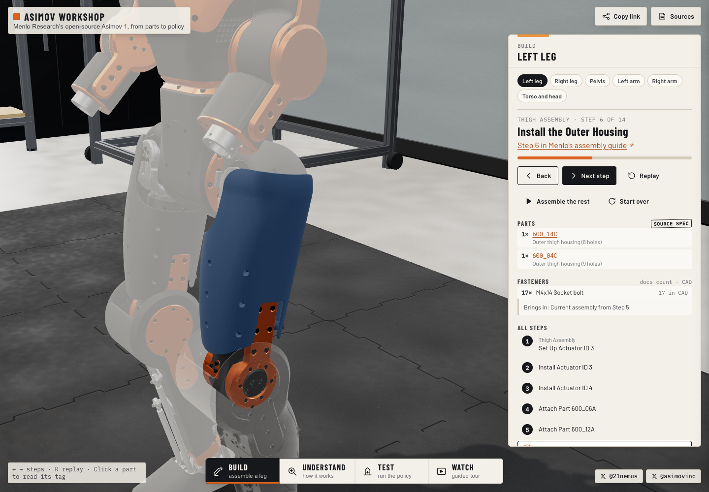

# Thigh housing display-mesh correction

Verified locally on 2026-10-21, branch `fix/build-thigh-housing-mesh`, based on
`b2ba3344fc5d4100e25240a5b02261377d59fda4`. The maintainer reviewed the local
preview and approved merging and pushing the fix to `main`. Deployment remains
a separate manual action.

## Finding

BUILD left leg step 6 contains `600_14C` and `600_04C`; the brief's `600_08C`
was a transcription error. The reported fragments reproduce in development and
production, with the ordinary material, selected-part highlighting, ghosts off,
and isolated `MeshNormalMaterial` proxies without the other robot meshes.

The defect originates in CAD-to-mesh conversion. Eight surfaces in the pinned
STEP export represent nearly spherical caps as `TOROIDAL_SURFACE`, with major
radius **−0.000137970042855 mm** and minor radii **57.5 and 60 mm** (CAD DERIVED).
`occt-import-js` 0.0.23 produces incorrectly trimmed triangles on this
near-degenerate representation. Its underlying OCCT version is 7.6.1, per the
[upstream release](https://github.com/kovacsv/occt-import-js/releases/tag/0.0.23).

This is an export/import compatibility problem, not evidence that the intended
engineering shape or the physical part is broken. It is unrelated to the earlier
simulation-mesh scale bug.

Evidence locating the failure:

- Raw tessellation already contains the fragments. Importing the separately
  published, pinned part STEP files gives exactly the same indices and vertex
  positions after Float32 conversion as splitting the assembly. The assembly
  splitter is therefore not introducing the damage.
- The original cap edge loops terminate at CAD **z = 80 mm**. Raw meshes extend to
  **114.9855 mm** (`600_04C`), **114.9562 mm** (`600_14C`) and **93.3463 mm**
  (`500_04C`). `500_14C` happens to triangulate cleanly but uses the same surface
  representation. These are CAD DERIVED measurements in the original part frame.
- The raw `600_04C` has 1,587 repeated triangles when positions are compared at
  1-micrometre precision. That count becomes zero after conditioning. Normals are
  finite and unit length in all four raw meshes, before and after.
- All 704,971 original shipped triangles have in-bounds vertex indices. All 1,184
  part ranges are contiguous and contain only vertices with the correct `_PART`.
  Isolating each housing proves the shards are not overlapping neighbours or
  transparent ghosts.
- The corrected asset before and after FILTER meshopt encoding has identical
  positions, part IDs and oriented triangles. Quantization transforms are retained.
  Part IDs, names, material classes, body assignments and registration transforms
  are unchanged. No part was moved to conceal the defect.

## Correction and scope

`tools/cad/display-surfaces.mjs` conditions the in-memory STEP text immediately
before tessellation. A torus approaches a sphere as its major radius approaches
zero. Replacing only these surfaces with their spherical limit displaces the
surface by at most **0.138 micrometres**, versus the existing **50-micrometre**
tessellation tolerance. This is a **CAD DERIVED display-only APPROXIMATION**.

The surface entity ID, axis placement, minor radius, face orientation and all
original edge/trim references are retained. The original STEP files and their
pins are unchanged. The guard requires the major radius magnitude to be at most
0.5 micrometres, one hundredth of the tessellation tolerance, and 1e-5 of the
minor radius. Real toroidal fillets, including the −439.48 / 507 mm surfaces in
these parts, are left alone.

Scanning all **3,684 toroidal surfaces** in the full assembly found exactly eight
matches, two in each housing. These are the only regenerated products:

- `500_04C`, part 560: source entities 766285 and 783823.
- `500_14C`, part 570: source entities 4526110 and 4802723.
- `600_04C`, part 785: source entities 3066737 and 4327705.
- `600_14C`, part 795: source entities 431830 and 1741756.

Per-part `displaySurfaceCorrections` in `parts.json` records those source entities,
original radii and maximum surface displacement. Tessellation invalidates old
affected caches automatically; a second run regenerated zero products.

Rebuild using the existing pinned source and registration cache:

```sh
node --max-old-space-size=6144 tools/cad/tessellate.mjs .reference-cache/cad/Asimov_1.STEP
node --max-old-space-size=6144 tools/build-robot.mjs
node tools/compress-glb.mjs public/robot/asimov-cad.glb public/robot/asimov-cad.glb
```

No new application or build dependency is required. A separate, ignored local
Python environment with `cadquery-ocp==7.9.3.1.1` was used only for diagnostic
inspection. Merely switching CAD-kernel versions was not used as the fix.

## Verification

Eight new tests bring the suite to **52 passed, 0 failed, 0 skipped** on this
machine. The four housing tests decode the shipped asset, reverse its node and
registration transforms, and check against CAD trim bounds with a 0.1 mm allowance.
They fail against the original asset for both left housings and `500_04C`, and
pass after regeneration. The other tests cover all part ranges and indices,
meshopt round trips, preservation of trim references, the analytical displacement
bound and refusal to condition ordinary toroidal surfaces.

`npx tsc --noEmit`, `npm run build`, and `npm run sources:verify` pass. Source
verification checked **62 files with 0 mismatches**.

Browser verification used headless Chrome 155 on Apple silicon, 1440 × 1000,
actual WebGL rendering. Development animation was advanced with the existing
manual-frame hook. Production was served from the ordinary Vite build.

- Left BUILD steps 5, 6, 7 and 14; right BUILD step 6; completed left assembly;
  full robot in EXPLORE: visually inspected.
- Both left housing parts: actual canvas clicks open the matching part tags.
- Highlighted and ordinary materials, ghosts disabled, separate raw housing
  proxies: the cap surfaces are continuous and the fragments are gone.
- UNDERSTAND: 60% explode and section controls exercised and inspected.
- TEST: physics initialized and robot rendered.
- WATCH: all beats ran through the live TEST sequence to the end card; no logged
  browser exceptions or errors.
- Runtime bundles, the 23-joint mapping, physics XML, policy assets and simulation
  mesh remain unchanged. Existing policy-equivalence tests pass.

Before and after use the same camera position, target, FOV and viewport. The
production check uses the normal automatic step framing, which adjusts slightly
because the erroneous housing bounds are now corrected.




Additional local diagnostics and screenshots are in `tools/.cache/thigh-bug/`
(ignored). These include the production captures, isolated meshes, picking,
adjacent steps, explode, section, TEST, WATCH, and numerical logs.

## Size and remaining limits

The compressed CAD asset changes from **7,492,696 to 7,485,716 bytes**, a reduction
of **6,980 bytes** (gzip: 5,674,267 to 5,669,581 bytes). `parts.json` grows from
838,730 to 840,394 bytes to include provenance. Triangle count changes from
704,971 to 705,096 (**+125, approximately 0.018%**); 1,184 parts and 131 merged
meshes remain. Runtime bundles are byte-identical. No FPS or real-device
performance improvement is claimed.

Only the four housing records change in `parts.json`. Requantizing their shared
material groups moves unaffected triangle vertices by at most **0.0302 mm**.
Their triangle counts, identities and assembly placements are unchanged.

This is a display correction, not a watertight engineering-mesh certification.
With a 1-micrometre weld, raw `600_04C` boundary edges fall from 3,207 to 66 and
`500_04C` from 872 to 92; one non-manifold edge remains in `500_04C`.
Both corrected `14C` raw meshes have zero boundary/non-manifold edges. The `04C`
meshes retain small trim/seam issues beyond the reported cap failure. A separate
OCCT 7.9.3 check also reports small BSpline-face orientation issues on `04C`;
this patch does not attempt broader CAD healing. Real phones, Safari, Firefox
and touch were not tested during this fix.

## Exact files changed and review status

- `tools/cad/display-surfaces.mjs`, `tools/cad/display-surfaces.d.mts`: guarded
  surface conditioning and its TypeScript declaration.
- `tools/cad/tessellate.mjs`: apply conditioning and invalidate affected caches.
- `tools/build-robot.mjs`: carry correction provenance into the part catalogue.
- `public/robot/asimov-cad.glb`, `public/robot/parts.json`: regenerated display asset
  and catalogue.
- `tests/cad-surfaces.test.ts`, `tests/cad-mesh.test.ts`,
  `tests/fixtures/thigh-housings.json`: numerical regression coverage.
- `docs/THIGH_MESH_FIX.md`, `docs/SOURCES.md`, `docs/DISCREPANCIES.md`,
  `docs/TEST_REPORT.md`, `docs/PROGRESS.md`: evidence, provenance and verification.
- `docs/evidence/thigh-housing-before.png`, `docs/evidence/thigh-housing-after.png`:
  browser-rendered evidence.

The maintainer accepted the local visual result and approved the merge and push
to `main`. Deployment remains a separate maintainer action.
